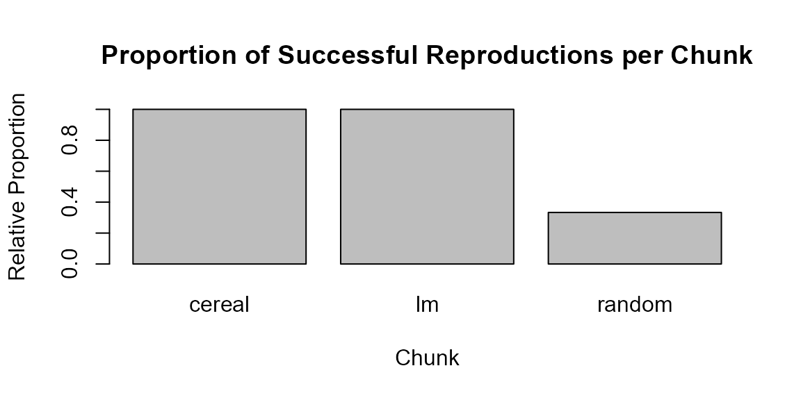

# Custom Reports

Here, I demonstrate how custom reports about the success of reproduction
of a document can be generated within a markdown document. To
illustrate, we first create three chunks using the code chunk type
`reproducibleR` of which the first two reproduce just fine while not all
variables of the third chunk reproduce. Finally, we generate custom
reports.

## Styling of chunk-level reports

The following code defines a new format for the chunk-level reports
based on HTML/CSS. We draw a thin dashed line as border and fill the box
with a light gray color. Last, we change the title.

``` r
options(reproducibleRchunks.templates = list(
html="<div style='border: 1px dashed gray;
padding: 15px 15px 5px 15px;
background-color: #F7F7F7;'>
<small><b>Reproducibility Checks</b><br>

${content}</small></div><br><br>"))
```

Next, we define some `reproducibleR` chunks of which some contain
reproducible and some non-reproducible parts.

## Cereals

In this first example we work with the `UScereal` data set from the
`MASS` package. The chunk loads the data, runs an analysis of variance
on calorie content by manufacturer and prints the summary of the model.

``` r
cereal_data <- MASS::UScereal
model <- anova(lm(calories~mfr, cereal_data))
summary(model)
#>        Df           Sum Sq          Mean Sq        F value         Pr(>F)      
#>  Min.   : 5.0   Min.   : 25769   Min.   :3789   Min.   :1.36   Min.   :0.2523  
#>  1st Qu.:18.5   1st Qu.: 75208   1st Qu.:4130   1st Qu.:1.36   1st Qu.:0.2523  
#>  Median :32.0   Median :124648   Median :4471   Median :1.36   Median :0.2523  
#>  Mean   :32.0   Mean   :124648   Mean   :4471   Mean   :1.36   Mean   :0.2523  
#>  3rd Qu.:45.5   3rd Qu.:174087   3rd Qu.:4812   3rd Qu.:1.36   3rd Qu.:0.2523  
#>  Max.   :59.0   Max.   :223527   Max.   :5154   Max.   :1.36   Max.   :0.2523  
#>                                                 NA's   :1      NA's   :1
```

**Reproducibility Checks**  

- ✅cereal_data: REPRODUCTION SUCCESSFUL

- ✅model: REPRODUCTION SUCCESSFUL

  
  

## Linear Model

The next chunk demonstrates a simple linear regression. We use the
`Animals` data from `MASS` to predict brain weight from body weight and
print the model summary.

``` r
animals <- MASS::Animals
model2 <- lm(brain~body, animals)
summary(model2)
#> 
#> Call:
#> lm(formula = brain ~ body, data = animals)
#> 
#> Residuals:
#>    Min     1Q Median     3Q    Max 
#> -576.0 -554.1 -438.1 -156.3 5138.5 
#> 
#> Coefficients:
#>               Estimate Std. Error t value Pr(>|t|)  
#> (Intercept)  5.764e+02  2.659e+02   2.168   0.0395 *
#> body        -4.326e-04  1.589e-02  -0.027   0.9785  
#> ---
#> Signif. codes:  0 '***' 0.001 '**' 0.01 '*' 0.05 '.' 0.1 ' ' 1
#> 
#> Residual standard error: 1360 on 26 degrees of freedom
#> Multiple R-squared:  2.853e-05,  Adjusted R-squared:  -0.03843 
#> F-statistic: 0.0007417 on 1 and 26 DF,  p-value: 0.9785
```

**Reproducibility Checks**  

- ✅animals: REPRODUCTION SUCCESSFUL

- ✅model2: REPRODUCTION SUCCESSFUL

  
  

## Random Numbers

The following chunk contains some fixed numbers and numbers that are
randomly drawn without setting a seed. Because the random numbers change
from run to run, the chunk mixes reproducible and non-reproducible
behaviour and serves as an example of how such situations are reported.

``` r
fixed_numbers <- 1:10
numbers <- rnorm(10, mean = 0, sd = 1)
```

**Reproducibility Checks**  

- ❌.Random.seed: **REPRODUCTION FAILED** Fingerprints are not
  identical.

- ✅fixed_numbers: REPRODUCTION SUCCESSFUL

- ❌numbers: **REPRODUCTION FAILED** Fingerprints are not identical.

  
  

## Report

After the chunks above have been executed, `reproducibleRchunks` stores
metadata about all created variables. The following code demonstrates
how to extract and summarise this information. We start by counting the
total number of variables that did not reproduce correctly:

``` r
num_errors <- reproducibleRchunks::get_num_reproducibility_errors()
 ifelse(num_errors > 0,"There were some results that did not reproduce!","The entire document reproduced succesfully")
#> [1] "There were some results that did not reproduce!"
```

The second function
[`get_reproducibility_summary()`](../reference/get_reproducibility_summary.md)
generates a table that can either be used to inspect details about the
reproduction status of each variable in each chunk, or to compute
further summaries from. First, we obtain the table:

``` r
repro_table <- reproducibleRchunks::get_reproducibility_summary()
knitr::kable(repro_table)
```

| Chunk  | Variable      | Success |
|:-------|:--------------|:--------|
| cereal | cereal_data   | TRUE    |
| cereal | model         | TRUE    |
| lm     | animals       | TRUE    |
| lm     | model2        | TRUE    |
| random | .Random.seed  | FALSE   |
| random | fixed_numbers | TRUE    |
| random | numbers       | FALSE   |

Next, we summarise the table by chunk and create a bar plot that
visualises the proportion of successful reproductions.

``` r
if (nrow(repro_table) > 0) {
  prop_success <- aggregate(Success ~ Chunk, data = repro_table, FUN = mean)
  
  barplot(prop_success$Success,
          names.arg = prop_success$Chunk,
          ylim = c(0, 1),
          ylab = "Relative Proportion",
          xlab = "Chunk",
          main = "Proportion of Successful Reproductions per Chunk")
} else {
  print("No reproducibility information available yet.")
}
```


