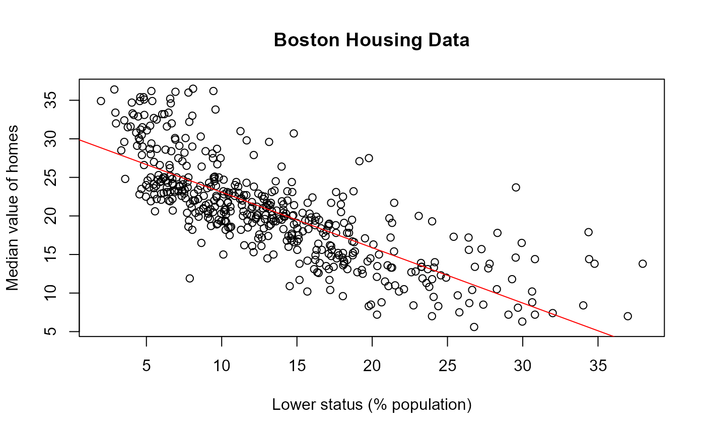

# Use Case: Linear Regression with Outlier Correction and Bootstrap

This vignette demonstrates how to perform a robust linear regression
analysis on the Boston housing data. We start by setting global chunk
options and loading the required packages.

``` r
library(reproducibleRchunks)
library(MASS)
```

## Load Data

We load the Boston housing data from the `MASS` package and display the
first rows to get an overview of the variables.

``` r
boston <- MASS::Boston
knitr::kable(head(boston))
```

|    crim |  zn | indus | chas |   nox |    rm |  age |    dis | rad | tax | ptratio |  black | lstat | medv |
|--------:|----:|------:|-----:|------:|------:|-----:|-------:|----:|----:|--------:|-------:|------:|-----:|
| 0.00632 |  18 |  2.31 |    0 | 0.538 | 6.575 | 65.2 | 4.0900 |   1 | 296 |    15.3 | 396.90 |  4.98 | 24.0 |
| 0.02731 |   0 |  7.07 |    0 | 0.469 | 6.421 | 78.9 | 4.9671 |   2 | 242 |    17.8 | 396.90 |  9.14 | 21.6 |
| 0.02729 |   0 |  7.07 |    0 | 0.469 | 7.185 | 61.1 | 4.9671 |   2 | 242 |    17.8 | 392.83 |  4.03 | 34.7 |
| 0.03237 |   0 |  2.18 |    0 | 0.458 | 6.998 | 45.8 | 6.0622 |   3 | 222 |    18.7 | 394.63 |  2.94 | 33.4 |
| 0.06905 |   0 |  2.18 |    0 | 0.458 | 7.147 | 54.2 | 6.0622 |   3 | 222 |    18.7 | 396.90 |  5.33 | 36.2 |
| 0.02985 |   0 |  2.18 |    0 | 0.458 | 6.430 | 58.7 | 6.0622 |   3 | 222 |    18.7 | 394.12 |  5.21 | 28.7 |

###### Code Chunk Reproduction Report

- ✅boston: REPRODUCTION SUCCESSFUL

## Outlier Correction

Next, we remove observations with extremely high or low values of `medv`
using the IQR rule to reduce the influence of outliers.

``` r
iqr_medv <- IQR(boston$medv)
q <- quantile(boston$medv, c(0.25, 0.75))
lower <- q[1] - 1.5 * iqr_medv
upper <- q[2] + 1.5 * iqr_medv
boston <- boston[boston$medv >= lower & boston$medv <= upper, ]
```

###### Code Chunk Reproduction Report

- ✅iqr_medv: REPRODUCTION SUCCESSFUL

- ✅lower: REPRODUCTION SUCCESSFUL

- ✅q: REPRODUCTION SUCCESSFUL

- ✅upper: REPRODUCTION SUCCESSFUL

## Linear Regression

We then fit a simple linear regression predicting median house value
from the percentage of lower status population (`lstat`).

``` r
model <- lm(medv ~ lstat, data = boston)
summary(model)
#> 
#> Call:
#> lm(formula = medv ~ lstat, data = boston)
#> 
#> Residuals:
#>      Min       1Q   Median       3Q      Max 
#> -12.6960  -2.6909  -0.7157   1.9776  14.6744 
#> 
#> Coefficients:
#>             Estimate Std. Error t value Pr(>|t|)    
#> (Intercept) 30.25803    0.41087   73.64   <2e-16 ***
#> lstat       -0.71853    0.02744  -26.19   <2e-16 ***
#> ---
#> Signif. codes:  0 '***' 0.001 '**' 0.01 '*' 0.05 '.' 0.1 ' ' 1
#> 
#> Residual standard error: 4.103 on 464 degrees of freedom
#> Multiple R-squared:  0.5964, Adjusted R-squared:  0.5956 
#> F-statistic: 685.7 on 1 and 464 DF,  p-value: < 2.2e-16
```

###### Code Chunk Reproduction Report

- ✅model: REPRODUCTION SUCCESSFUL

## Bootstrap Coefficients

To assess the variability of the coefficients we perform a simple
bootstrap. Because analyses based on random numbers lead to different
results across runs, we set a random seed to make this step
reproducible. See Brandmaier et al. for a detailed discussion of
reproducibility and random numbers
(<https://qcmb.psychopen.eu/index.php/qcmb/article/view/3763/3763.html>).

``` r
set.seed(123)
boot_coefs <- replicate(1000, {
  idx <- sample(nrow(boston), replace = TRUE)
  coef(lm(medv ~ lstat, data = boston[idx, ]))
})
boot_means <- rowMeans(boot_coefs)
boot_means
#> (Intercept)       lstat 
#>   30.282183   -0.720951
```

###### Code Chunk Reproduction Report

- ✅.Random.seed: REPRODUCTION SUCCESSFUL

- ✅boot_coefs: REPRODUCTION SUCCESSFUL

- ✅boot_means: REPRODUCTION SUCCESSFUL

## Plot

Finally, we visualise the relation between `lstat` and `medv` together
with the fitted regression line. Since plots do return objects, they are
not tested for reproducibility.

``` r
plot(boston$lstat, boston$medv,
     xlab = "Lower status (% population)",
     ylab = "Median value of homes",
     main = "Boston Housing Data")
abline(model, col = "red")
```



###### Code Chunk Reproduction Report

No variables were created within this chunk. Cannot generate a
reproduction report.
